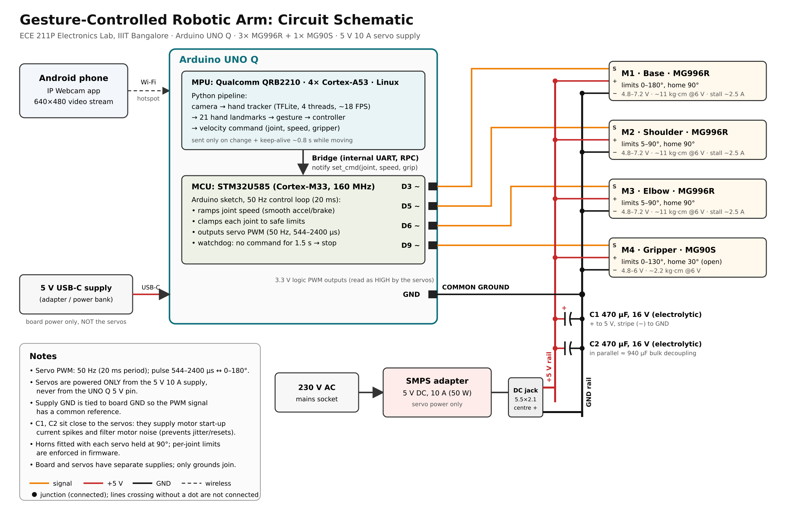

# Gesture-Controlled Robotic Arm

A 4-DOF robotic arm controlled by hand gestures, running entirely on an **Arduino UNO Q**: no laptop at run time.
A phone camera streams video to the board, the board tracks the hand in real time, and the arm moves accordingly.

ECE 211P Electronics Lab, IIIT Bangalore · Instructor: Prof. Madhav Rao

| # | Name | Roll No. |
|---|---|---|
| 1 | Ved Savjani | BE2025029 |
| 2 | Huma Khadarabad | IE2025017 |
| 3 | Devbrat Singh | BE2025010 |
| 4 | Krtin Singhvi | IE2025019 |
| 5 | Siddha Dhok | IE2025010 |
| 6 | Divyesh Jogi | IE2025011 |

## Demo video

▶️ **[Watch the demo on YouTube](https://www.youtube.com/watch?v=22aBzl2RXOY)**

## Key features

- **Fully on-board:** hand tracking, gesture recognition and servo control all run on the UNO Q.
- **Real-time hand tracking at ~18 FPS** on the board's 4-core ARM processor, using Google's hand-landmark models run directly on TFLite with 4 threads (~3× faster than MediaPipe on this board).
- **9 gestures** for base, shoulder, elbow, gripper, home and stop.
- **Distance-based speed control:** hand far from the camera = fast moves, hand close = slow, precise moves.
- **Smooth motion:** the microcontroller ramps joint speed up and down (soft acceleration and braking).
- **Low-traffic control link:** the Linux side sends a command only when the gesture changes, instead of streaming angles continuously.
- **Safety:** per-joint angle limits in firmware, and the arm stops automatically if commands stop arriving for 1.5 s.

## How it works

```
Phone camera (IP Webcam) ──Wi-Fi──► UNO Q: Linux side (Qualcomm QRB2210, 4× Cortex-A53)
                                     camera → hand tracker (21 landmarks) → gesture → controller
                                                         │
                                                Bridge (internal UART)
                                     set_cmd(joint, speed, gripper), sent only on change
                                                         ▼
                                     UNO Q: STM32U585 microcontroller (Cortex-M33)
                                     50 Hz loop: speed ramping, joint limits, servo PWM
                                                         ▼
                                     4 servos ──► arm moves
```

The board has two processors, and each does what it is good at:
- **Linux processor:** heavy computation (video and neural networks), but no precise timing.
- **Microcontroller:** precise real-time timing, which servo PWM needs.

## Vision models

Google's hand landmarker (the same models MediaPipe uses), run directly on the TFLite runtime (`ai-edge-litert`) with 4 threads, in two stages:

| | Palm detector | Hand landmark model |
|---|---|---|
| File | `hand_detector.tflite` | `hand_landmarks_detector.tflite` |
| Job | Finds the hand in the full frame | Reads 21 hand keypoints from a crop around the hand |
| Input | 192×192 RGB, scaled 0–1 (letterboxed) | 224×224 RGB crop, rotated so the hand points up |
| Output | 2,016 candidate boxes, each with a score + 7 palm keypoints | 21 landmarks (x, y, z), hand-presence score, handedness |
| Parameters | ~1.1 M | ~2 M |
| Compute | ~0.35 GFLOPs per inference | not published |
| Weights | float16 | float16 |
| Time on UNO Q, 4 threads | 62–65 ms | 45–46 ms |
| When it runs | Only when no hand is being tracked | Every frame |

Once a hand is found, each next crop is built from the previous frame's 21 points, so the slower palm detector is skipped while tracking. That gives **~18 FPS while tracking** and 8–13 FPS while searching.
Both models ship together in Google's float16 `hand_landmarker.task` bundle. Parameter and GFLOP figures are approximate, from published model cards for these models; timings were measured on the board (`experiments/bench_tflite.py`).

## Gestures

| Gesture | Action |
|---|---|
| ☝️ index finger | Base left |
| ✌️ index + middle | Base right |
| 3 fingers | Shoulder up |
| 4 fingers (thumb folded) | Shoulder down |
| 👍 thumbs up | Elbow up |
| 🤙 pinky up | Elbow down |
| 👌 OK sign | Gripper open / close (toggle) |
| ✊ fist | Glide back to home pose |
| ✋ open palm | Stop / hold |

Start with ✋ so the tracker locks on, then switch gestures without leaving the frame.

## Hardware

| Component | Details |
|---|---|
| Controller | Arduino UNO Q (Qualcomm QRB2210 + STM32U585) |
| Camera | Android phone running IP Webcam, 640×480, over the phone's hotspot |
| Base, shoulder, elbow | 3× MG996R servo: nylon gears, rated ~11 kg·cm at 6 V, 4.8–7.2 V, ~55 g each |
| Gripper | 1× MG90S servo: ~2.2 kg·cm at 6 V, 4.8–6 V, ~13 g |
| Servo power | 5 V 10 A SMPS adapter (separate from the board) |
| Decoupling | 2× 470 µF electrolytic capacitors across the servo supply |
| Board power | 5 V USB-C |
| Arm frame | Bench Robotics 3D-printed arm kit |

| Joint | Servo | Pin | Limits | Home |
|---|---|---|---|---|
| Base | MG996R | D3 | 0–180° | 90° |
| Shoulder | MG996R | D5 | 5–90° | 90° |
| Elbow | MG996R | D6 | 5–90° | 90° |
| Gripper | MG90S | D9 | 0–130° | 30° (open) |

Wiring rules:
- Servos are powered **only** from the 5 V 10 A supply, never from the board's 5 V pin.
- The supply GND is tied to the board GND (common ground for the PWM signal).
- The capacitors sit across the servo supply, close to the servos, to absorb motor current spikes.



## Results

| Metric | Value |
|---|---|
| Hand tracking | ~18 FPS while tracking (MediaPipe on the same board: ~6 FPS) |
| End-to-end latency | ~0.7 s (mostly phone capture and Wi-Fi) |
| Control traffic | 0 messages/s at rest, ~1–2/s while moving (previously 20/s constantly) |
| Servo update rate | 50 Hz |

## Repository structure

```
python/       Linux side: camera.py, hand.py (tracker), gestures.py, controller.py, main.py, config.py
sketch/       STM32 firmware (sketch.ino)
experiments/  TFLite thread benchmark
docs/         Schematic, tracker test images, detailed developer notes
notes/        Benchmark results
```

## Running it

1. **Phone:** install IP Webcam, set 640×480, turn on the hotspot and start the server. The board finds the phone automatically as the hotspot gateway.
2. **Models:** download Google's hand landmarker into `python/models/`:
   ```bash
   mkdir -p python/models
   wget -O python/models/hand_landmarker.task https://storage.googleapis.com/mediapipe-models/hand_landmarker/hand_landmarker/float16/1/hand_landmarker.task
   python3 -m zipfile -e python/models/hand_landmarker.task python/models/
   ```
3. **Arduino App Lab:** create an app with `python/` and `sketch/`, add the **Servo** library, and press **Run**.
4. Power the servos, show ✋ to the camera, and start gesturing.

Full setup, design decisions, tests and troubleshooting: [docs/DEVELOPER_NOTES.md](docs/DEVELOPER_NOTES.md).

## License

MIT
